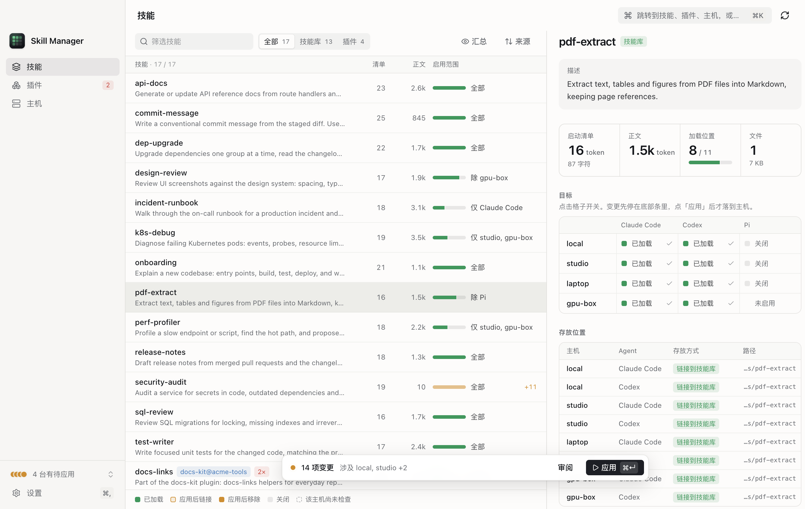
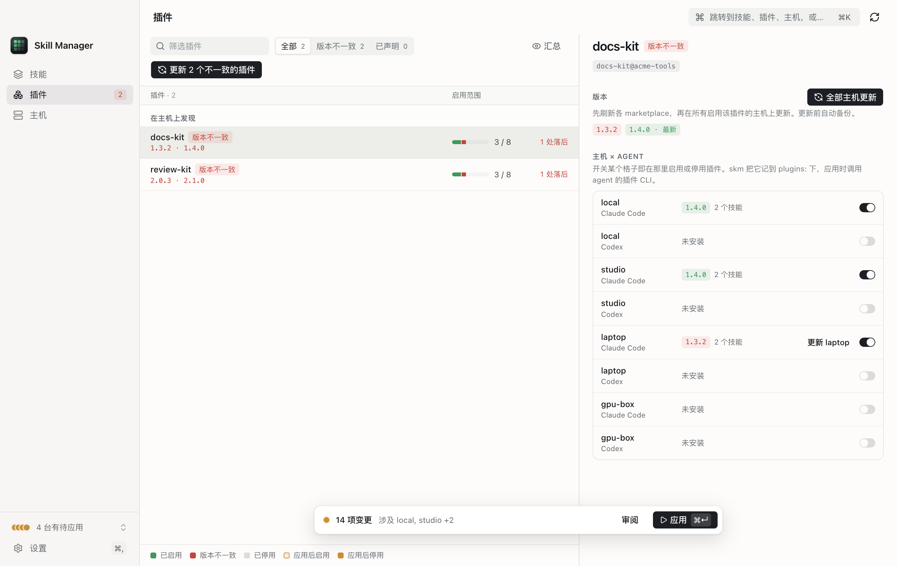

# Skill Manager（skm）

[](https://github.com/jokerlin/skill-manager/actions/workflows/ci.yml)
[](LICENSE)

[English](README.md) | 简体中文

在一个地方管理 **多台机器 × 多个编程 agent × 每个单元格的配置** 下的 skill 和 plugin。

skm 在主力机上保存一份 skill store，把它软链到每个 agent 的 skill 目录，再通过 ssh 镜像到其他机器。skm 也跟踪每个 agent 加载的 plugin、CLI 版本和桌面应用，一次就能看到并修复所有主机上的不一致。skm 有 CLI（带 TUI）和 macOS 桌面 App 两种形态。

内置支持的 agent：**Claude Code**、**Codex**、**Pi**。其他 agent 可以用[扩展](docs/zh-CN/extensions.md)加入。



```
~/.skm/skills/<name>/SKILL.md     ← store，唯一事实源
~/.claude/skills/<name>    ─┐
~/.agents/skills/<name>    ─┼─→ 软链到 store（Claude Code / Codex / Pi）
~/.pi/agent/skills/<name>  ─┘
mini:~/.skm/skills  devbox:~/.skm/skills   ← rsync 镜像，在各主机本地再软链
```

远端主机只需要 `ssh`、`rsync` 和 POSIX `sh`，不用安装任何东西。

## 为什么用 skm

多数 skill 管理工具只管一台机器上的一个 agent。skm 把你的环境看成一张网格：每个 skill 或 plugin 在每个 **主机 × agent** 单元格上都有目标状态。

- **一张网格管全部。** 规则决定 skill 去哪些主机和 agent（`only`、`except`、glob）。也可以只翻转一个单元格，比如「这台笔记本上的 Codex 不加载这个 skill」。
- **以 agent 真正加载的内容为准。** skm 列出每个 agent 启动时读取的所有来源：用户目录、旧目录、内置 skill、plugin 缓存。每一条都标出归谁管、占多少上下文。
- **plugin 和 harness 一起管。** skm 显示每台主机每个 agent 上的 plugin 版本，并更新不一致的 plugin。它也检查并更新每台主机上的 agent CLI（`claude`、`codex`、`pi`）。
- **默认安全。** 每次同步前先在每台主机上备份，并生成 `restore.sh`。除非你明确要求，skm 不删除真实目录。一台主机不可达不影响其他主机。

## 功能

- 按每个 agent 自己的算法，计算每个 主机 × agent 的上下文预算（listing 预算和正文大小）。
- 发现项：同名 skill、同一 skill 被加载两次、被遮蔽的副本、过期的 plugin 缓存、版本漂移。
- App 底部的待应用变更栏：每次修改先排队，按主机审阅后再应用。
- 跨主机更新 plugin（`skm plugin update`），包括随桌面应用分发的 plugin。
- Harness 更新：在每台主机上并行执行各 agent CLI 自带的更新命令。
- 用 `claude -p` 或 `codex exec` 让 LLM 评估你的 skill（`skm eval`）。
- 扩展：写一个 YAML 文件就能加入 agent 和技能来源（比如某个 registry），不用写代码。
- 界面支持英文和简体中文，支持浅色和深色主题。

## 安装

### Homebrew

```sh
brew tap jokerlin/tap
brew trust jokerlin/tap                 # Homebrew 7 起，第三方 tap 要先 trust 才会加载
brew install --cask skill-manager       # macOS App（自带 skm CLI）
brew install skill-manager-cli          # 或者只装 skm CLI 和 TUI（macOS 和 Linux）
```

App 自己会更新（见[更新](#更新)），所以 `brew upgrade` 会跳过它。`brew upgrade skill-manager-cli` 更新 CLI。formula 不叫 `skm`，因为 homebrew-core 里已经有一个 `skm`（SSH key 管理工具）。两者都会装一个 `skm` 命令，所以互相冲突。

### 桌面 App（macOS）

1. 从 [Releases](https://github.com/jokerlin/skill-manager/releases) 下载 `skill-manager-<版本>-arm64-mac.zip`（Apple 芯片）或 `-x64-mac.zip`（Intel）。
2. 解压，把 `Skill Manager.app` 移到 `/Applications`。
3. 打开它。从 0.4.1 起，App 用 Developer ID 签名并经过 Apple 公证。macOS 只会问一次「是否打开从互联网下载的 App」，点 **打开** 即可。

App 里自带 `skm` CLI，不用另外安装。之后的新版本在 App 内安装（见[更新](#更新)）。

### CLI

从 [Releases](https://github.com/jokerlin/skill-manager/releases) 下载对应平台的二进制（`skm-darwin-arm64`、`skm-darwin-x64`、`skm-linux-x64`、`skm-linux-arm64`），然后：

```sh
shasum -a 256 -c SHA256SUMS --ignore-missing   # 校验下载
install -m 755 skm-darwin-arm64 ~/.local/bin/skm
```

也可以用 [Bun](https://bun.sh) 1.3 或更高版本从源码构建：

```sh
git clone https://github.com/jokerlin/skill-manager.git
cd skill-manager
bun install
bun run build                # → dist/skm，单文件可执行
cp dist/skm ~/.local/bin/skm
```

## 快速上手

```sh
skm init                         # 创建 ~/.skm/config.yaml 和 store，列出未纳管的 skill
skm adopt --from claude codex pi # 把真实目录搬进 store，原位置留软链
skm status                       # 探测每台主机：每个 agent 加载了什么、漂移、冲突
skm pull mini --all              # 把只有远端才有的 skill 拉回 store
skm rules infer --write          # 按各主机现状生成范围规则
skm plan                         # 查看 sync 会做什么
skm sync                         # 备份 → rsync → 在每台主机上建软链
skm                              # 打开 TUI
```

警告：`skm sync --replace-conflicts` 会把远端主机上的真实目录移进备份，再换成软链。先看 `skm plan`。

## 配置

skm 读取 `~/.skm/config.yaml`：

```yaml
store: ~/.skm/skills
agents: [claude, codex, pi]            # 内置 id，加上扩展里的 agent
hosts:
  laptop: {}                           # 必须恰好有一台主机不写 ssh：它是 hub（本机）
  mini: { ssh: mini }                  # ~/.ssh/config 里的别名
  devbox: { ssh: devbox, agents: [claude, codex] }
defaults: { hosts: all, agents: all }  # 没有规则命中时 skill 的去向
rules:                                 # 自上而下，后面的规则覆盖前面的；skills 支持 glob
  - skills: ["docs-*"]
    hosts: { except: [devbox] }
  - skills: ["work-*"]
    hosts: { only: [mini, devbox] }
  - skills: [hatch-pet]
    agents: { only: [codex] }
    off: ["mini/codex"]                # 单个 主机/agent 单元格
plugins:                               # plugin 的目标状态，通过 claude / codex CLI 落地
  superpowers: { marketplace: claude-plugins-official, agents: { only: [claude, codex] } }
  humanizer: { marketplace: claude-extras, enabled: false }
owned:                                 # 由其他 CLI 自己安装和更新的 skill
  acme:
    tool: acme                         # owner CLI
    agents: [claude, codex]            # 该 CLI 自己写的目录；skm 只核对，不在这里建软链
    ensure: acme skill install acme    # 目录缺失且主机有该 CLI 时执行
    lock: { file: ~/.local/share/acme/skill-lock.json, version: "skills.{skill}.version" }
    fallback: store                    # 主机没有该 CLI 时：链接 store 副本（或 `none`）
upstreams:                             # store 副本来自某个 git 仓库的 skill（`skm upstream`）
  kit:
    repo: https://github.com/acme/kit  # `git clone` 能接受的地址都行
    ref: main                          # 可选：分支、tag 或 commit；默认跟最新的 vX.Y.Z tag
    path: skills/{skill}               # 可选：skill 在仓库里的位置（这是默认值）
    skills: [review, debug]
eval: { agent: claude }
agentOverrides:                        # 可选：改某个 agent 的 skill 目录或更新命令
  pi: { dir: ~/.pi/agent/skills, update: "pi update --all" }
contextTokens: 1000000                 # skm 读不到模型时的兜底上下文窗口
backupBeforeApply: true
```

一个单元格开启的条件：主机选择器和 agent 选择器都命中，再套用 `on` / `off` 单元格覆盖，并且该 agent 在这台主机上启用。桌面 App 会替你编辑这个文件（设置页，以及各视图里的单元格开关）。

## 命令

| 命令 | 作用 |
|---|---|
| `skm` | TUI：skills、plugins、hosts、changes、help 五个视图（`?` 列出按键） |
| `skm init` | 创建配置和 store，列出未纳管的 skill |
| `skm adopt <path…> \| --from <agent…>` | 把真实目录搬进 store 并留下软链 |
| `skm ls` / `skm show <skill>` | store 里的 skill 及上下文成本；单个 skill 的详情和网格 |
| `skm status` / `skm inventory` | 探测主机：每个 agent 从各个来源加载的内容 |
| `skm plan` / `skm sync` | 计算并执行同步；先备份，完成后重新探测 |
| `skm plugins` / `skm plugin update` | 每个 主机 × agent 的 plugin 版本；更新不一致的 plugin |
| `skm harness` / `skm harness update` | agent CLI 和桌面应用的版本；执行更新 |
| `skm extensions` | 已加载的扩展和错误 |
| `skm scope <name> <host/agent> on\|off` | 开关一个单元格（plugin 加 `--plugin`） |
| `skm config` / `skm config patch` | 打印配置；从 stdin 读 JSON，校验后写回 |
| `skm pull <host> [skills…]` | 把远端独有的 skill 拉回 store |
| `skm upstream` / `skm upstream update` / `skm upstream adopt` | 来自 git 仓库的 skill：上游改了什么；把新版本写进 store；开始跟踪 store 里的 skill |
| `skm rules infer` | 按各主机现状推导主机规则 |
| `skm backup` / `skm backups` / `skm restore <host> <ts>` | 快照和一键还原 |
| `skm doctor` | 规范检查、预算模拟、跨主机 plugin 漂移 |
| `skm eval [skills…]` | 让 LLM 评估有用度、描述质量和重复 |

多数命令支持 `--json`、`--host` 和 `--cached`（用上次探测的缓存，不走 ssh）。运行 `skm <command> --help` 查看全部选项。[工作原理](docs/zh-CN/how-it-works.md)说明了来源、发现项和上下文预算公式。

## 桌面 App

App 是 CLI 外面的一层 Electron 外壳，所有逻辑都在 `skm` 里：App 读 `skm … --json`，写操作调用 `skm scope` 和 `skm config patch`，同步和更新读 `--events` 的 NDJSON 进度。

- **技能**：全部 skill 的表格。「覆盖」列显示一句话的范围（「全部」「仅 mini」「除 Codex」「7 / 12」），主机和 agent 再多也不变宽。悬停看完整网格，在详情面板里点格子开关。`upstreams:` 下的 skill 会显示状态。「可更新」筛选和一个按钮就能把所有上游新版本写进 store，详情面板列出你的版本之后的上游提交。
- **插件**：每个 plugin 在每个 主机 × agent 上的版本。版本不一致标红，一个按钮更新全部不一致的 plugin。

  

- **主机**：主机 → agent 主从视图，含 listing 预算、来源构成、每条已加载的 skill，以及 agent CLI 版本。
- **待应用变更**：修改先排在底部栏里（`⌘↵` 应用），应用前可以按主机审阅。
- **设置**（`⌘,`）：语言、外观、主机（拖拽排序、改名、ssh 别名）、agent、扩展、store 路径、备份。
- **命令面板**（`⌘K`）：跳到任意 skill、plugin 或主机，或执行操作。

## 扩展

扩展是 `~/.skm/extensions/` 里的一个 YAML 文件。它可以加入 skm 没有内置的 agent，或给 [upstream](#来自-registry-的-skill) 用的技能来源：

```yaml
# ~/.skm/extensions/opencode.yaml
agents:
  - id: opencode
    name: OpenCode
    skillsDir: ~/.config/opencode/skills
    cli: { bin: opencode, update: opencode upgrade }
```

扩展只包含数据。只有你运行 `skm harness update` 或在 App 里点更新时，skm 才执行 agent 的更新命令；只有检查或更新使用某个来源的 upstream 时，skm 才执行该来源的命令。完整格式见 [docs/zh-CN/extensions.md](docs/zh-CN/extensions.md)。

### Codex 桌面 App（ChatGPT.app）

Codex 桌面 App 的安装包是 `/Applications/ChatGPT.app`。它自己写两个 plugin marketplace：`openai-bundled` 和 `openai-primary-runtime`，任何 CLI 命令都不会刷新它们。skm 把这个 App 当作内置 codex agent 的一部分（id 是 `chatgpt`）。`skm harness` 显示它在每台主机上的版本，没装时显示「not installed」。插件视图把它的 plugin 标为「随应用分发」。`skm harness update --agent chatgpt` 在一台主机上更新它：

1. skm 从 App 的 Sparkle appcast 读取最新版本。
2. skm 下载新版，用 `codesign --verify --deep --strict` 校验签名，并确认 Team ID 和已安装的 App 相同。
3. skm 把旧版移到该主机的 `~/.skm/backups/app/`，安装新版。
4. skm 在后台打开 App，等它重写完 marketplace、下载完 runtime。
5. 如果 App 原来没在运行，skm 再把它退出。

## 上游 skill

从某个仓库复制来的 skill（比如 GitHub 上的一套 skill）可以跟踪这个仓库。skm 在 `~/.skm/cache/upstreams/` 保存仓库的 bare 镜像，并在 `~/.skm/upstreams.lock.json` 记录每个 store 副本来自上游哪个 commit。

```sh
skm upstream adopt kit --repo https://github.com/acme/kit   # 仓库里也有的 store skill 全部纳入
skm upstream                     # 先 fetch，再列出每个 skill 的状态和你的版本之后的上游 commit
skm upstream update --all        # 备份 → 把新版本写进 store → 记录版本
skm sync                         # 和其他 store 改动一样，同步到每台主机
```

| 状态 | 含义 | `update` 的行为 |
|---|---|---|
| current | store 副本等于目标版本 | 不动 |
| update available | store 副本是 skm 写入的版本，上游有了新版本 | 写入目标版本 |
| edited locally | skm 写入之后，store 副本被改过 | 拒绝；`--force` 先备份再覆盖 |
| unknown base | 没有版本记录，且文件和目标版本不同 | 拒绝；运行 `skm upstream adopt` 找出版本，或用 `--force` |
| not in store | 列在 `skills:` 里，但 store 里没有 | 写入 |
| gone upstream | 目标 ref 里没有这个目录 | 不动 store 副本 |

`adopt` 能找出手动安装的副本是哪个版本：它找文件和 store 副本完全相同的最新上游 commit。skm 默认跟最新的 release tag（`vX.Y.Z`）。要跟某个分支，设置 `ref:`；只想这一次换 ref，用 `--to <ref>`。只有 hub 需要 `git`。skm 直接从 git 对象写文件，所以 `.gitattributes` 的 export 规则不影响写进 store 的内容。

### 来自 registry 的 skill

不在 git 仓库、而在某个 registry 里的 skill，用[扩展](docs/zh-CN/extensions.md#技能来源)定义的技能来源。扩展写明两条 shell 命令：一条打印某个 skill 的最新版本，一条下载某个版本。upstream 写明用哪个来源，以及这个来源需要的参数：

```yaml
# ~/.skm/config.yaml
upstreams:
  team-kit:
    source: my-registry     # ~/.skm/extensions 里定义的来源
    namespace: team/kit     # 这个来源的参数，命令里用 $NAMESPACE 读取
    skills: [doc-writer]
    # ref: 1.4.0            # 可选：固定一个版本，不跟最新版
```

`skm upstream`、`skm upstream update`、TUI 和 App 对它的处理和 git upstream 相同：状态、备份和 lock 都一样。每个 skill 有自己的版本。registry 没有提交历史，所以这类 skill 不列上游提交，`adopt` 也不适用：已经等于最新版本的副本显示为「current」，`skm upstream update` 会把它记进 lock。skm 把下载过的每个版本保存在 `~/.skm/cache/sources/`，所以 `--cached` 检查不运行任何命令。

TUI 在 skills 列表里给每个上游 skill 加标记（`↑` 有更新，`✎` 本地改过，`≠` 版本未知，`✗` 上游已删除），详情面板列出上游 commit。`u` 更新选中的 skill，`U` 更新所有有新版本的 skill，两者都先确认。本地改过的副本要单独确认一次才会被覆盖。

## 更新

桌面 App 每次启动时在 GitHub Releases 上检查一次新版本（可在 设置 → 通用 里关闭，也可以在「关于」里手动检查）。

- 每个 release 带一个清单文件 `latest-mac.json`，记录每个 zip 的 SHA-512 和大小。发布流水线用 Ed25519 私钥给清单签名，App 用 `desktop/package.json` 里的公钥验证签名。签名验证不通过，App 不安装这个更新。
- App 用 4 条连接同时下载对应架构的 zip（HTTP Range 请求）。某条连接的速度不到其他连接的 1/4 时，App 会重开它；到最后，闲下来的连接会接手慢连接剩下的字节。下载完按签名清单里的 SHA-512 校验，在重启时替换 App。
- 上一个版本保留在 `~/Library/Application Support/Skill Manager/updates/previous.app`。App 启动时删除已经装过的版本的下载包。
- App 用 Developer ID 签名。已签名的 App 只安装代码签名校验通过、且 Team ID 相同的新版本。
- release 没有签名清单，或构建里没有 `updatePublicKey` 时，App 只打开 release 页面，不自动安装。自己发布 release 的 fork 需要换成自己的密钥（见 [CONTRIBUTING.zh-CN.md](CONTRIBUTING.zh-CN.md#发布)）。
- release 里的文件带 GitHub [构建来源证明](https://docs.github.com/actions/security-for-github-actions/using-artifact-attestations)。用 `gh attestation verify <文件> --repo jokerlin/skill-manager` 校验下载。

skm 用自己的更新器，没有用 Squirrel.Mac（`electron-updater`）。这样没有 Developer ID 的 fork 或本地构建，也能通过签名清单更新。

设置环境变量 `SKM_UPDATE_API`，可以把 App 的更新源换成其他 GitHub 兼容 API（镜像、GitHub Enterprise、本地测试服务器）。

## 安全边界

- skm 只删除「指向 store、且 hub 认识该 skill」的软链。真实目录、指向别处的软链、远端独有的 store skill 一律保留，除非你加 `--replace-conflicts`（这时先移入备份）。
- plugin 和 owned skill 的变更只通过 owner 的 CLI 落地（`claude plugin`、`codex plugin`、`ensure` 命令），skm 从不改 plugin 缓存。主机上没有对应 CLI 时，这条变更显示为 `blocked`。
- 每次同步在每台目标主机上写入 `~/.skm/backups/<ts>/`，包含 `snapshot.tar.gz`、`manifest.txt` 和 `restore.sh`。用 `skm restore <host> <ts>` 还原，或在主机上运行 `sh ~/.skm/backups/<ts>/restore.sh`。

## 开发

```sh
bun install && (cd desktop && bun install)
bun test                 # 纯核心、用临时 HOME 跑真实 sh/rsync 的集成测试、TUI 渲染
bun run typecheck
cd desktop && bun run dev
```

结构：`src/core`（纯函数）→ `src/shell`（文件系统、ssh、rsync、子进程）→ `src/cli` 和 `src/tui`；`desktop/` 是 Electron App。提 pull request 前请先读 [CONTRIBUTING.md](CONTRIBUTING.md)。

## 许可证

[MIT](LICENSE) © 2026 jokerlin
